# Armor Studio

**Client-side armor customization for Minecraft 26.x on Fabric and NeoForge.**

Keep wearing your full Netherite armor and still show off your skin. Hide single pieces or everything, use separate
settings for yourself and for other players, make armor translucent, recolor it, control glint and trims, keep an eye on
durability with a configurable HUD, and switch between profiles with a key press.

Everything is purely visual and happens only on your own client:

- Your real equipment, armor points, enchantments and durability never change.
- No packets are sent; servers and other players do not need the mod.
- Works in singleplayer, on multiplayer servers and on Realms.

> Other players only see your armor the way *their* client renders it. Without Armor Studio they always see your real
> armor. This is a technical limit of any client-side mod, not a bug.

| Vanilla | Invisible Armor | Helmetless |
|---|---|---|
| 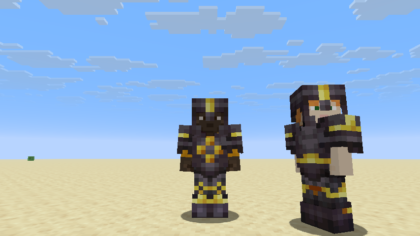 | 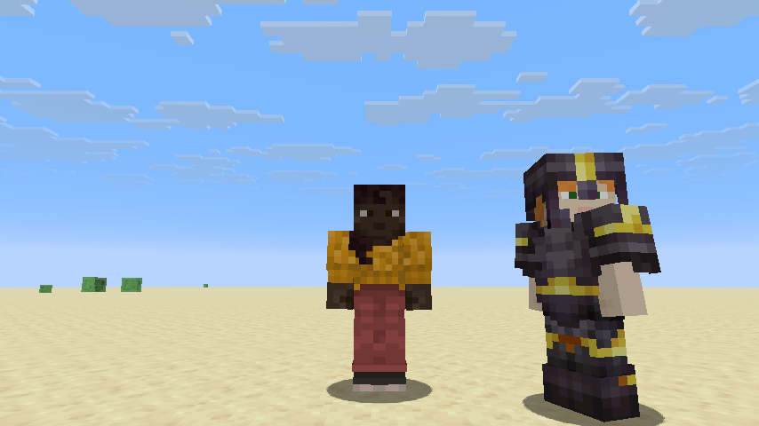 | 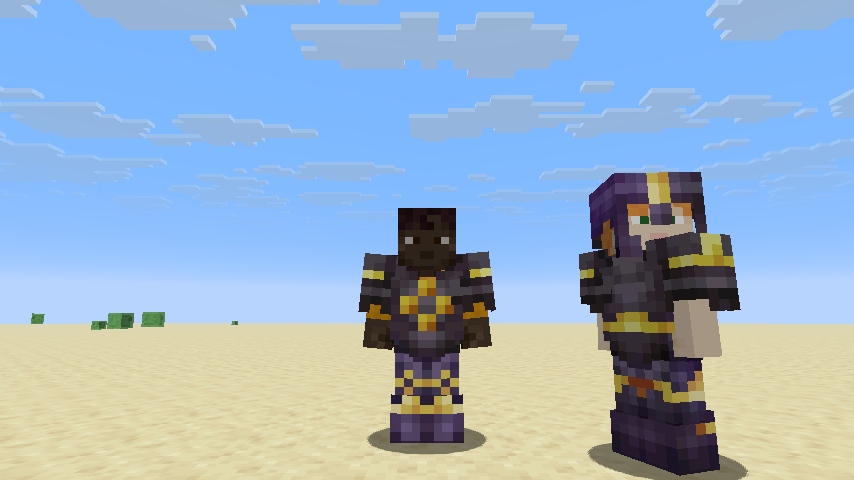 |
| **Translucent + tinted** | **Tinted, no glint, no trims** | **Other players' armor hidden** |
| 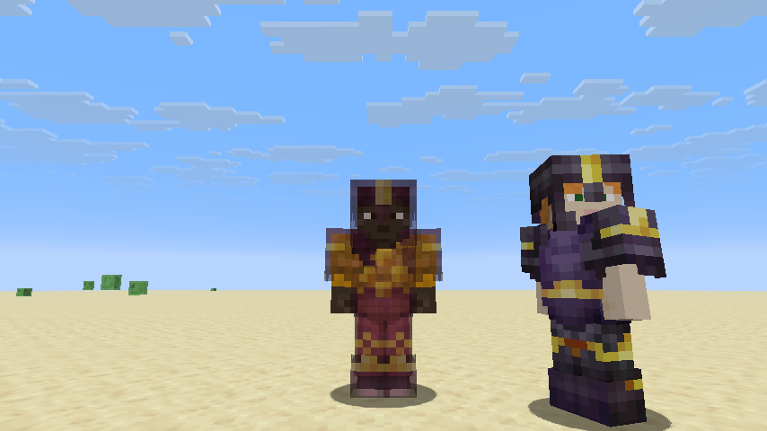 | 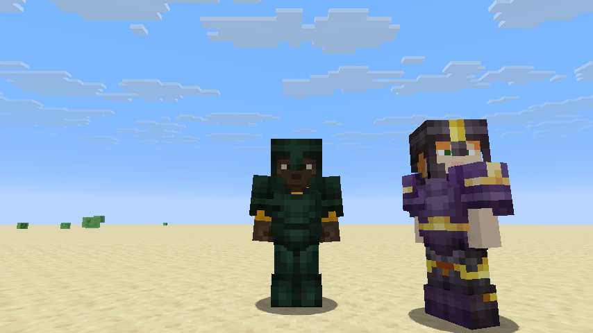 | 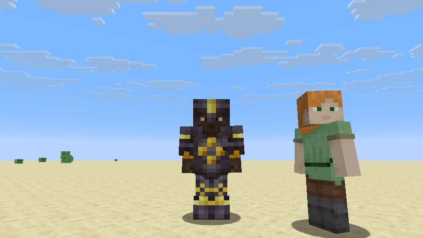 |
| **Translucent elytra** | **Inventory model** | **Armor HUD** |
| 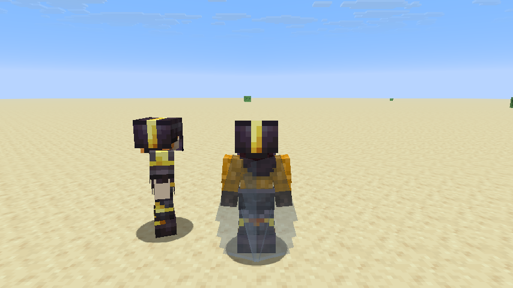 | 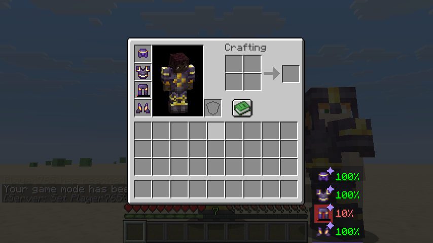 | 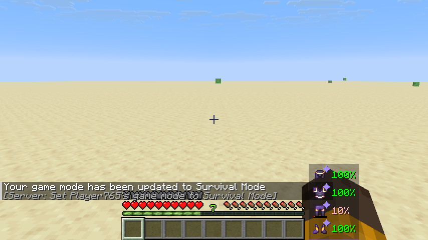 |

| Settings: Armor Appearance | Settings: Player Visibility | Settings: Profiles |
|---|---|---|
| 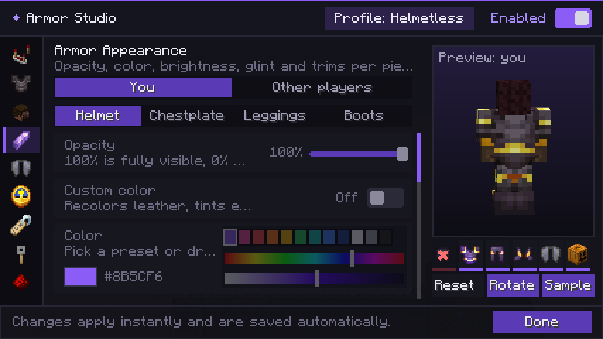 | 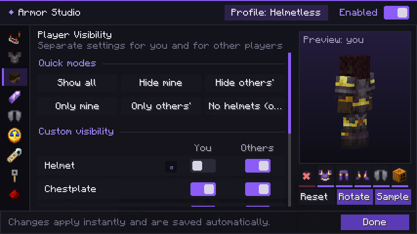 | 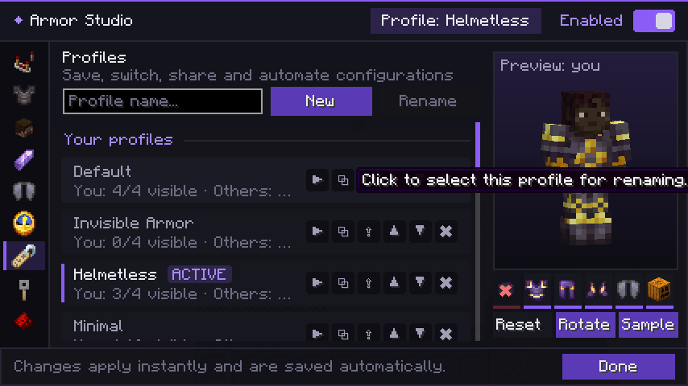 |

*Real in-game screenshots (Minecraft 26.3, Fabric) taken by the automated self test. The player on the left is you,
the figure on the right is a mannequin standing in for "other players".*

---

## Supported versions

| Minecraft | Fabric (Loader 0.20.1+, Fabric API) | NeoForge | Notes |
|---|---|---|---|
| 26.1, 26.1.1, 26.1.2 | ✅ `0.155.3+26.1.2` | ✅ 26.1.2.x (26.1.2 only) | Built against 26.1.2; stable NeoForge exists only for 26.1.2 |
| 26.2 | ✅ `0.161.0+26.2` | ✅ 26.2.0.x | |
| 26.3 | ✅ `0.165.0+26.3` | ✅ 26.3.0.x | Uses the reworked 26.3 equipment renderer |
| 26.4 | — | — | Only snapshots exist (Nov 2026); see [Updating to a new Minecraft version](#updating-to-a-new-minecraft-version) |

Java 25 is required (as by every Minecraft 26.x release). Each Minecraft version has its own jar:
`armorstudio-fabric-<version>+<mc>.jar` and `armorstudio-neoforge-<version>+<mc>.jar`.

## Installation

**Fabric**
1. Install [Fabric Loader](https://fabricmc.net/use/) for your Minecraft version.
2. Put [Fabric API](https://modrinth.com/mod/fabric-api) and `armorstudio-fabric-…+<mc>.jar` into `.minecraft/mods`.

**NeoForge**
1. Install [NeoForge](https://neoforged.net/) for your Minecraft version.
2. Put `armorstudio-neoforge-…+<mc>.jar` into `.minecraft/mods`.

Install it on the client only. Installing it on a server does nothing (it is marked client-only on both loaders).

Press **O** in game to open Armor Studio. On NeoForge you can also use the *Config* button in the mod list.

---

## Features

### Armor visibility
Show or hide the helmet, chestplate, leggings and boots independently ("Hide all" / "Show all" / any combination).
Hidden pieces are removed from the *render state*, a per-frame snapshot that only the renderer reads, so the armor
stays equipped and keeps protecting you. Because the piece is removed before any armor layer runs, this also hides
armor drawn by other mods' custom armor renderers, and your cape hangs as it would without a chestplate.

Head items (carved pumpkins, mob and player heads, banners) have their own switch.

### You and other players
Every profile has two complete looks: one for **you** and one for **all other players**. Quick modes on the
*Player Visibility* page:

- Show all · Hide mine · Hide others'
- Only mine · Only others' · No helmets (others)

Below them, a matrix of switches controls every piece (plus elytra and head items) for you and for others. A quick-toggle
key (**H**) hides all of your own armor instantly, regardless of the profile. Mannequins can optionally use the
"other players" look.

### Armor appearance (per piece, for you and for others)
- **Opacity** 0–100 % (smooth translucency; see limitations)
- **Custom color** with presets, hue and shade bars, and a strength slider. Leather is recolored completely (its
  texture is grayscale); other materials are tinted multiplicatively.
- **Brightness** 20–100 %
- **Enchantment glint**: Default / Hidden / Always
- **Armor trims**: show or hide
- "Apply to all pieces" and "Reset this piece"
- Minecraft's own *Glint strength* and *Glint speed* accessibility options are available on the General page
  (global, they affect every enchanted item)

### Elytra & equipment
The elytra is managed independently of the chestplate: visibility, opacity, color, brightness and glint.

### Armor HUD
- All four equipped pieces with item icon and vanilla durability bar
- Durability as percent, exact points, both, or icons only; colored green → red
- Low-durability highlight (blinking), plus an optional one-time warning sound and action-bar message
- Position: 8 anchors (corners, edges, next to the hotbar) with offsets, or **drag it into place** in the HUD editor
- Size 50–200 %, background opacity, vertical or horizontal layout
- Optional enchantment marker; the *Armor HUD* page lists your equipped armor with full tooltips (enchantments) on hover
- Always shows your real equipment, even pieces you have hidden visually

### Live preview
The settings screen shows a 3D preview of your own player rendered through the normal player renderer, so it shows
exactly what the world shows. Drag to rotate, scroll to zoom, *Reset view*, auto-rotate. On pages with a *You / Other
players* selector, the preview shows the "other players" look on your skin. The strip under the preview toggles
helmet, chestplate, leggings, boots, elytra and head items directly. *Samples* fills empty slots with example
Netherite armor (enchanted and trimmed) in the preview only, so you can judge styles without wearing armor.

### Profiles
- Built-in presets: **Default**, **Invisible Armor**, **Helmetless**, **Minimal**, **PvP**, **Custom**
- Create, rename, duplicate, reorder and delete profiles
- Export: copies JSON to the clipboard and saves `config/armorstudio/exports/<name>.json`
- Import from the clipboard or from every file in `config/armorstudio/imports/`
- *Restore presets* re-adds deleted built-in presets
- **Automatic switching**: a profile for singleplayer, for multiplayer (default), for Realms, and per server address.
  Automatic switching never changes your own selection; leaving the world restores it, so no settings leak from one
  server to another.

### Keybinds
Registered through Minecraft's regular key binding system (category *Armor Studio*):

| Action | Default |
|---|---|
| Open Armor Studio | O |
| Toggle my armor | H |
| Toggle other players' armor | not bound |
| Next / previous profile | not bound |
| Toggle armor HUD | not bound |
| Toggle Armor Studio (master switch) | not bound |

The *Keybinds* page shows every binding and warns when a key is also used by another binding. A short, optional
notification confirms profile switches and toggles.

### Settings screen
Dark theme with violet accents, nine categories (General, Armor Visibility, Player Visibility, Armor Appearance,
Elytra & Equipment, Armor HUD, Profiles, Keybinds, Compatibility), animated switches and sliders, a description under
every setting with a full tooltip, a reset button for every setting that differs from its default, and a layout that
adapts to the window size and GUI scale (the sidebar collapses to icons and the preview hides on small screens).
Changes apply immediately and are saved automatically.

### Inventory model
Choose what the player model in the inventory shows: the same look as in the world, your real armor, or no armor.

---

## Feature status

**Fully implemented**
- Hide/show each armor piece, hide all/show all, head items (pumpkins, heads, banners), elytra independent of the chestplate
- Separate looks for you and other players, six quick modes, per-piece matrix, quick-hide key, optional mannequin styling
- Per-piece opacity, custom color (leather recolor / tint), brightness, glint mode, trim visibility, "apply to all", per-piece reset
- Elytra opacity, color, brightness and glint
- Armor HUD with all options listed above, drag-and-drop position editor, low-durability warnings, detail list with tooltips
- Live 3D preview (rotate, zoom, reset, auto-rotate, sample armor, direct toggles, "other players" preview)
- Profiles: six presets, create/rename/duplicate/reorder/delete, export/import (clipboard and files), automatic switching
  for singleplayer, multiplayer, Realms and per server, without leaking settings between worlds
- Seven key bindings through Minecraft's key binding system with conflict warnings; optional notifications
- Inventory model mode, master switch, per-setting reset, config reload/reset, opacity fallback for shaders
- NeoForge mod list *Config* button

**Partially implemented / limited**
- Glint intensity: only Minecraft's global *Glint strength* / *Glint speed* options (exposed on the General page)
- Colors multiply the texture (except leather), so armor can not be made brighter than its texture
- Armor with custom models from other mods: hiding works, color/opacity only for the vanilla equipment renderer
- 26.3: translucent pieces can not show the glint (the glint is baked into the opaque armor render type there)
- Fabric: no Mod Menu button (the mod has no dependencies besides Fabric API); open the screen with **O**

**Not available**
- Separate first-person settings: Minecraft never draws armor in first person, so there is nothing to change
- A simplified armor model: would require custom models and textures; left out instead of shipping a placeholder
- Showing your cosmetic changes to other players: impossible without server-side support; intentionally not implemented
- Per-piece glint intensity and changes to accessory slots of other mods

---

## Configuration file

`config/armorstudio.json` (written atomically; a broken file is backed up as `armorstudio.json.broken-<time>` and replaced
with defaults). It is loaded when the game starts. *Compatibility → Reload from disk* re-reads it after manual edits.

---

## Compatibility

| Mod | Status |
|---|---|
| Sodium / Embeddium | Expected to be compatible: they change terrain rendering; armor is drawn by Minecraft's entity renderer. |
| Iris / Oculus (shaders) | Hiding, colors, glint and trims use vanilla render paths. Smooth opacity uses a translucent render type; if a shader pack draws it incorrectly, set *Compatibility → Opacity rendering* to **Hide below 50%**. |
| Custom armor models (GeckoLib, Fabric `ArmorRenderer`, NeoForge client item extensions) | Hidden correctly (the piece is removed before rendering). Color/opacity apply only to armor drawn by the vanilla equipment renderer. |
| Cosmetic Armor style mods | Armor Studio styles whatever is on the rendered model; hiding a slot also hides the cosmetic item shown there. |
| Curios / Trinkets / Accessories | Accessory slots are drawn by those mods and are not changed. |
| Figura / player-model replacements | Avatars that replace the player model may draw their own armor. |

The Compatibility page lists which of these mods are installed. Mixins use MixinExtras `@WrapOperation` (bundled
with both loaders) instead of `@Redirect`/`@Overwrite`, so other mods can hook the same calls.

These compatibility notes are based on how the mods render, not on in-game tests with each mod.

---

## Known limitations

- **Client-side only.** Other players see your real armor unless they also use Armor Studio.
- **Colors can not brighten textures.** The game colors armor by multiplying the texture, so a tint can shift and
  darken colors but not make dark armor brighter. Leather is the exception (fully recolorable).
- **Translucent pieces and glint.** Glint on see-through armor looks like a glitch, so *Default* hides it on
  translucent pieces. *Always* still draws it on 26.1.x/26.2. On 26.3 the glint is baked into the opaque armor render
  type and translucent pieces are drawn without glint.
- **Glint intensity** can only be changed globally (Minecraft's *Glint strength*/*Glint speed* options), not per piece.
- **First person.** Minecraft does not draw armor on the first-person arm, so first-person settings would have
  nothing to change. Everything applies in third-person views, inventory and preview screens.
- **Shaders.** Translucent armor depends on the shader pack's handling of translucent entities (use the threshold fallback if needed).
- Accessory slots from other mods and armor drawn by fully custom renderers can be hidden, but not recolored.

---

## Building from source

Requirements: JDK 25 (Gradle runs on it; the build also selects a Java 25 toolchain).

```bash
./gradlew build                          # Minecraft 26.1.2 (default)
./gradlew build -Pmc_version=26.2
./gradlew build -Pmc_version=26.3
```

The jars are written to `build/libs/`. GitHub Actions builds every version × loader combination on each push and
attaches all jars to a release when a `v*` tag is pushed (`.github/workflows/build.yml`).

Development runs: `./gradlew :fabric:runClient` / `./gradlew :neoforge:runClient`. An automated in-game check is
available as `runSelfTest` on both loaders (see [Testing](#testing)).

### Project layout

```
common/src/main/java/com/armorstudio/
  config/     settings model (Gson), presets, loading/saving
  profile/    profile selection, automatic switching, import/export
  render/     look resolution and render-state editing (no loader code)
  mixin/      mixins shared by all versions
  hud/        armor HUD, durability warnings, notifications
  gui/        settings screen, widgets, live preview, HUD editor
  dev/        in-game self test (excluded from release jars)
versions/
  <mc>.properties              dependency versions per Minecraft version
  overlays/renderer-v1/        equipment renderer mixin for 26.1.x and 26.2
  overlays/renderer-v2/        equipment renderer mixin for 26.3 (reworked renderer)
fabric/     Fabric entry point (key mappings, HUD element, tick and shutdown events)
neoforge/   NeoForge entry point (same, plus the mod list config button)
```

### How it works

1. `AvatarRendererMixin` runs after vanilla filled in a player's render state and asks `LookResolver` which look
   applies (you, other players, inventory preview, settings preview). The resolved look is cached per config revision,
   so the per-frame cost is one integer comparison.
2. `ArmorStateEditor` removes hidden pieces from the render state and stores the look on it (`LookHolder`).
3. `HumanoidArmorLayerMixin` and `WingsLayerMixin` announce which piece is about to be drawn; the
   `EquipmentLayerRendererMixin` (versioned overlay) then adjusts color, alpha, render type, glint and trims, bound to
   the exact `ItemStack` instance so no other equipment (horse armor, wolf armor) is ever affected.
4. Nothing touches entities, items, inventories or networking.

### Updating to a new Minecraft version

1. Add `versions/<mc>.properties` with the Fabric API, NeoForge and version ranges.
2. Build with `-Pmc_version=<mc>`. If the equipment renderer changed, add a new overlay under `versions/overlays/` and
   reference it from the properties file. Everything else lives in `common/`.
3. Run `runSelfTest` on both loaders.

---

## Testing

Release builds compile for every supported version and loader. Because a green build proves nothing about
rendering, the project includes an **automated in-game self test** (`./gradlew :fabric:runSelfTest` /
`./gradlew :neoforge:runSelfTest`, add `-Pmc_version=<mc>`). It starts a real client, creates a flat test world, equips
enchanted and trimmed Netherite armor on the player and on a mannequin, and then:

- switches through presets, translucency, tint, glint/trim hiding, "others hidden", the quick toggle, elytra styles, the
  inventory screen, every settings page and the HUD editor, taking a screenshot of each;
- checks with the real renderer that hidden pieces are removed from the render state while the equipment stays
  equipped and the armor points stay at 20;
- checks that profiles and HUD settings survive a save/reload of the config file.

### Results (November 2026)

| Minecraft | Fabric | NeoForge |
|---|---|---|
| 26.1.2 | ✅ 24/24 checks, all mixins applied | ✅ 24/24 checks, all mixins applied |
| 26.2 | ✅ 24/24 | ✅ 24/24 |
| 26.3 | ✅ 24/24 | ✅ 24/24 |

The screenshots were reviewed manually for 26.1.2 and 26.3 (hiding, translucency, tint, glint/trim hiding, elytra,
inventory, HUD and settings UI); for 26.2 only the automated checks were run.

### Not tested yet (needs a manual check)

- Real multiplayer servers and Realms (only the integrated server was used; other players were simulated with a
  mannequin, which uses the same player renderer).
- Automatic profile switching per server address / Realms (logic only; singleplayer detection is exercised).
- Interactive use of every widget with mouse and keyboard (dragging sliders, color picker, HUD drag editor, profile
  rename/import/export). The screens were opened and rendered, not clicked through.
- Keybinds pressed in game, low-durability sound/message, profile notifications.
- Shader packs (Iris/Oculus), Sodium and all other mods listed under *Compatibility*.
- Minecraft 26.1 and 26.1.1 (jar built against 26.1.2; mixin targets were verified identical by bytecode comparison).
- Different GUI scales and very large or very small windows (tested at 854×480 with GUI scale auto).

---

## License

MIT, see [LICENSE](LICENSE). The project contains no Minecraft assets; the icon is original.
